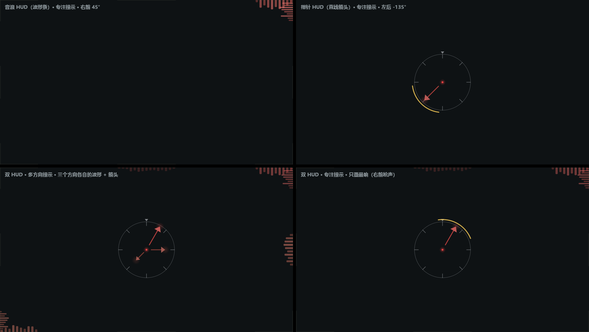
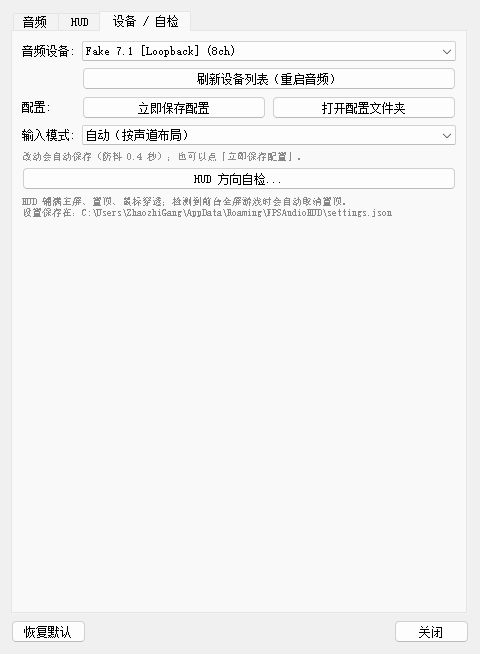
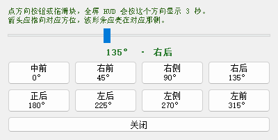
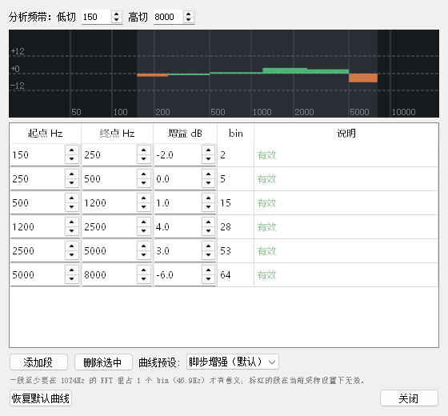

# FPS 听障辅助音频 HUD

给听障玩家的 FPS 游戏声音方向辅助工具：实时捕获系统输出音频，分析声音来源的**方位**，
用铺满屏幕的 HUD 显示方向。没有小雷达窗口，画面上只有三样东西：

- **屏幕四边 + 四个角的 12 段声音波形条** —— 哪边有声音，那边的柱子就跳起来；
- **屏幕正中的刻度盘 + 直线箭头** —— 箭头指向声源方向，**不显示任何文字**；
- **准星位置一个红色中心点** —— 固定不动的对齐参考。

HUD 无黑色背景、置顶、鼠标穿透，不挡操作；所有参数都在一个设置窗口里，透明程度可调。

支持的声道：立体声(2ch) / 4.0(4ch) / 5.1(6ch) / 6.1(7ch) / 7.1(8ch)。



---

## 1. 安装与首次运行（从源码）

本项目只以**源码**形式提供，不附带预编译的可执行文件；按下面步骤用 Python 运行即可。

### 1.1 系统要求

| 项目 | 要求 |
|---|---|
| 系统 | Windows 10 / 11（64 位） |
| Python | 3.9 及以上（64 位） |
| 依赖 | numpy / pyaudiowpatch / PyQt5（见 `requirements.txt`） |
| 音频 | 任意输出设备即可；想要"前后方向"需要 5.1/7.1 虚拟声卡（见 1.4） |

### 1.2 步骤 1：安装 Python

1. 从 [python.org](https://www.python.org/downloads/) 下载 3.9+ 的 **64 位**安装包；
2. 安装时勾选 **Add Python to PATH**；
3. 打开 PowerShell 执行 `python --version`，能打印版本号即成功。

### 1.3 步骤 2：安装依赖

1. 把项目文件夹放到任意路径（路径尽量不要有空格和中文）；
2. 在该目录打开终端；
3. （可选）建虚拟环境，避免污染全局：

```powershell
python -m venv .venv
.\.venv\Scripts\activate
```

4. 安装依赖：

```powershell
pip install -r requirements.txt
```

### 1.4 步骤 3：配置系统音频（决定"能不能听到前后"）

1. 装一个 7.1 虚拟声卡（Voicemeeter / VB-Audio Cable 均可），把游戏输出接到它上面；
2. Windows 设置 → 系统 → 声音 → 输出设备 → 配置扬声器 → 选 **7.1 环绕**；
3. **关掉** Windows Sonic、Dolby Atmos for Headphones、耳机驱动的虚拟 7.1 / 3D 音效；
4. 游戏内音频输出选 **7.1 / 家庭影院 / 环绕**，不要选"耳机 / 立体声"。

> 只想要左右、不想折腾虚拟声卡：跳过这一步，启动后在托盘 → **输入模式 → 立体声**，
> 左右会被拉到两侧；前后仍然无法区分（这是立体声的物理限制）。

### 1.5 步骤 4：启动

```powershell
python fps_audio_radar.py
```

或双击 `启动.bat`（首次运行会自动安装依赖）。
启动后托盘出现图标，全屏 HUD 立刻出现（静默状态：边缘细线 + 中心刻度盘 + 红点）。

### 1.6 步骤 5：确认抓对了设备

看托盘第一行 `音频: 8ch 48000Hz 7.1 · 设备名`：

- `8ch` / `6ch` = 抓到了多声道，能算前后；
- `2ch` = 抓到的是立体声，只能算左右；
- 设备名不对（抓到了显示器或另一块声卡）→ 托盘 → **音频设备** 切换，
  或「全部设置 → 设备 / 自检 → 刷新设备列表」。

### 1.7 步骤 6：首次校准（4 步，约 5 分钟）

1. **静音 3 秒**：HUD 不应闪出任何方向（启动阶段的假方向已在源码里修掉）；
2. **站着不动**：环境音不应让 HUD 常亮；常亮就把等效阈值抬到 1.9~2.0（见 3.1）；
3. **方向自检**：托盘 → **HUD 方向自检...**，八个方向逐个点，箭头指对、波形条亮在对应边角；
4. **实测距离**：队友在 10 / 30 / 50m 各静步、跑步一次，记下哪种条长对应哪个距离，
   再决定用「低 / 中 / 高」哪一档。

### 1.8 步骤 7（可选）：安装 EQ 曲线

1. 安装 [Equalizer APO](https://sourceforge.net/projects/equalizerapo/)，安装时勾选你那根 7.1 虚拟声卡；
2. 进入 `eq/` 目录，双击 **安装EQ.bat**（自动提权、备份 config.txt、写入曲线并追加 Include）；
3. 打开 Equalizer APO Configurator → **Restart audio service**（或重启游戏）；
4. 卸载：双击 **卸载EQ.bat**，config.txt 恢复原样。

详见 `eq/README.md`（含实测数据与三种落地方式）。

### 1.9 命令行参数

| 参数 | 作用 |
|------|------|
| `--debug` | 控制台每秒打印一次各声道电平 + 识别到的方向，排查用 |
| `--no-audio` | 只显示 HUD、不启动音频（排查显示问题） |
| `--hud off` / `wave` / `pointer` / `dual` | 启动时的 HUD 形态：关闭 / 波形条 / 箭头 / 双 HUD |
| `--hint focus` / `multi` | HUD 提示逻辑：专注提示 / 多方向提示 |

---

## 2. 界面与交互

### 2.1 四种显示模式

| 显示模式 | 画什么 | 适合 |
|---|---|---|
| **双 HUD**（默认） | 边缘波形条 + 中心箭头一起画 | 通用 |
| **音浪** | 只画屏幕四边 + 四个角的 12 段波形条 | 余光看边缘，完全不挡准星 |
| **指针** | 只画屏幕正中的刻度盘 + 直线箭头 | 需要"精确指向"时 |
| **关闭** | 什么都不画 | 临时不想看 |

- **波形条**贴着屏幕四边，不占画面中央；斜方向（左前/右后…）是两个角落段一起亮，形成 L 形；
- **箭头**在屏幕正中（准星位置），第二个声源起长度依次内缩，几根箭头叠在一起也分得清；
- HUD 上不画任何文字，方位只靠形状表达（见 2.3 的中心红点与 2.2 的提示逻辑）。

### 2.2 两种提示逻辑

| 提示逻辑 | 行为 | 什么时候用 |
|---|---|---|
| **专注提示** | 只保留**最响**的一个声源：一根箭头 + 一圈会呼吸的锁定环，其它声源不画 | 对枪、脚步乱成一团，只想知道"最该看哪边" |
| **多方向提示**（默认） | 同时画最多 4 个声源（可在设置里改到 6），每个声源一根箭头 + 自己那侧的波形条；方位差 < 25° 的自动合并 | 想同时掌握"左边脚步 + 正前枪声" |

多方向提示的数据来自**声道聚类**：一个音频块里 BL 和 FR 同时响时，单一矢量求和会把它平均成
一个"中左"，那个方向其实谁都不在；现在按声道角度聚类（相邻声道差 ≤65° 算同一声源，
所以 7.1 的 FL/FR/C 会正确合成"正前"），每个簇单独求方向，就能同时给出两个真实方向。

### 2.3 中心红点

准星位置固定一个红点，**任何状态都在**（静默时也在），用来对齐屏幕中心：

- 托盘 → **中心红点** → 1~8 px，或「不显示」；
- 或用 全部设置 → HUD 页 → 「准星红色中心点」+ 「中心点大小」；
- 它和 HUD 颜色无关，永远是红色，避免和声音提示的颜色混在一起。

### 2.4 托盘菜单

HUD 本身不接收鼠标（点击穿透），日常控制走**系统托盘图标**（右下角任务栏）：

| 菜单项 | 功能 |
|------|------|
| 音频: 8ch 48000Hz 7.1 · 设备名 | 当前抓的是哪个设备的回环（只读） |
| **EQ 分析频带** | 打开 EQ 窗口（多段自定义）/ 全带 60–12000 / 抗低频轰鸣 150–8000（推荐）/ 强抗低频 200–6000 / 只要脚步带 250–5000 / 自定义… |
| 音频设备 | 机器上有多个回环设备时手动切换 |
| **HUD 显示** | 双 HUD（默认）/ 音浪 / 指针 / 关闭 |
| **HUD 提示逻辑** | 专注提示 / 多方向提示 |
| **HUD 提示档位** | 轻提示 / 平衡（默认）/ 明显 |
| **HUD 颜色** | 红色（默认）/ 按声音类型 / 橙色 / 青色 / 绿色 / 白色 |
| **中心红点** | 不显示 / 1~8 px（默认 3 px） |
| **HUD 设置...** | 打开设置窗口并跳到 HUD 页 |
| **输入模式** | 自动（按声道布局）/ 立体声（只按前左/前右，左右拉满） |
| 方向增益(准星) | 0.8 / 1.0 / 1.2 / 1.5 / 1.8 / 2.0 |
| **全部设置...** | 打开设置窗口（默认音频页） |
| **HUD 方向自检...** | 点八个方向，看 HUD 指得对不对 |
| 退出 | 关闭程序（参数自动保存） |

### 2.5 全部设置窗口

托盘 → **全部设置...**，一个窗口放齐所有可调项，改动**即时生效**，不需要点"应用"：

| 页签 | 内容 |
|---|---|
| **音频** | 一键预设（低/中/高）、灵敏度、信噪比阈值、方向增益、噪声门下限、提示保留秒数、**低切/高切**、**打开 EQ 多段窗口**、**实时声道电平表**、自动诊断 |
| **HUD** | 显示模式、提示逻辑、提示档位、提示颜色、尺寸、**元素不透明度**、**整体透明**、光晕、多方向上限、中心点大小、三个显示开关（波形条 / 箭头 / 红点） |
| **设备 / 自检** | 音频设备切换 + 刷新、输入模式、**立即保存配置 / 打开配置文件夹**、HUD 方向自检入口、设置文件位置 |

| 音频页 | HUD 页 | 设备页 |
|---|---|---|
|  |  |  |

窗口底部：**恢复默认**（音频 + HUD 一起还原）、**关闭**。

所有改动**自动保存**（0.4 秒防抖），点「关闭」、按 Esc、点托盘快捷项、退出程序都会立即写盘，
重开程序参数保持原样，不会被初始化。

### 2.6 透明调整

两个独立参数，互不干扰：

- **整体透明**：20%~100%，默认 100%。整块 HUD 统一乘一个透明度——刻度盘、波形条、箭头、红点一起变淡；
- **元素不透明度**：0.15~1.00，默认 0.82。只管波形条/箭头本身的浓度，不影响刻度盘和红点。

> 想最不抢眼：整体透明 50% + 元素不透明度 0.5，再配「轻提示」档位。

### 2.7 方向自检

托盘 → **HUD 方向自检...**（或设置窗口 → 设备 / 自检页）：

1. 点 `左前 / 中前 / 右前 / 左后 ...` 八个按钮，或拖滑块（0°~359°）；
2. 全屏 HUD 按这个方向显示 3 秒：**箭头要指到对应方位，波形条要亮在对应的边/角**；
3. 关掉窗口后预览自动消失，不影响真实的声音提示。



这一步验证的是**显示**。如果显示都对、但游戏里方向还是不对，问题在**读取**
（抓错设备 / 游戏只输出立体声 / 声道接反），用第 4.1 节的电平表确认。

### 2.8 位置、性能与全屏行为

- 1920×1080 全屏重绘约 **3.4 ms/帧**（30fps 刷新），基本不占 CPU；
- 箭头和红点固定在屏幕正中，波形条贴屏幕四边；
- HUD 铺满主屏、置顶、鼠标穿透（`WS_EX_LAYERED | WS_EX_TRANSPARENT`）；
- 检测到前台全屏游戏时自动取消置顶（避免压坏独占全屏），退出全屏后自动恢复；
- 多显示器：只铺主屏。

---

## 3. 参数一览

### 3.1 音频参数（全部设置 → 音频页）

| 参数 | 默认 | 范围 | 说明 |
|------|------|------|------|
| 灵敏度 | 1.0 | 0.5~2.5 | 阈值的缩放系数：**实际生效阈值 = 信噪比阈值 ÷ 灵敏度**。1.0 中性，越大越灵敏；设置页会实时显示"等效阈值"，低于 1.25 会被钳住（稳定环境音本来就有 ~1.1 的 snr，再低整块 HUD 会常亮） |
| 信噪比阈值 | 1.8 | 1.0~5.0 | 信号比底噪强多少倍才触发提示（和灵敏度一起决定等效阈值） |
| 方向增益 | 1.4 | 0.5~3.0 | 1.0 = 完全按声道能量计算（最准）；>1 左右/前后更分明但更容易抖；<1 更平滑。默认 1.4 = 少量锐化 |
| 噪声门下限 | 0.008 | 0.001~0.05 | 只在完全没声音时兜底；8 声道下自适应底噪≈0.011 早已盖过它，一般不用动 |
| 提示保留(秒) | 1.4 | 0.5~3.0 | 声音停止后提示淡出的时间；一个脚步只占 40ms，这个值决定看不看得见 |
| 低切/高切 | 150 / 8000 | 20–20000 | 就是这套雷达的 EQ：只影响检测、不改音频。抬低切挡低频轰鸣，降低高切砍雨水/枪声尾音；可自由改，托盘也有快捷档 |

三档一键预设（**等效阈值**才是真正生效的判定线，三档分别是 2.5 / 1.8 / 1.25）：

| 预设 | 灵敏度 | 信噪比阈值 | 等效阈值 | 方向增益 | 噪声门 | 提示保留 | 分析频带 | 适用场景 |
|---|---|---|---|---|---|---|---|---|
| 低 | 0.8 | 2.0 | 2.50 | 1.2 | 0.015 | 1.7 | 60–12000 | 防误报：基本不闪假方向，代价是漏远处 |
| 中（默认） | 1.0 | 1.8 | 1.80 | 1.4 | 0.008 | 1.4 | 150–8000 | 推荐：能抓 30m 级静步，条长仍反映远近 |
| 高 | 1.6 | 2.0 | 1.25 | 1.8 | 0.003 | 1.2 | 150–8000 | 灵敏：阈值贴地板，误报最多，只适合安静环境 |

> 等效阈值越低 = 越远的弱脚步也会亮，误报也越多。经验值：安静环境 1.4~1.5，有语音/有音乐 1.8~2.0，
> 想看"条长=距离"的梯度就抬到 2.2~2.4。低于 1.25 已经贴着底噪，HUD 会常亮，没有意义。
>
> 另外：底噪窗口刚启动时不再用 1e-4 的种子值（那会让开机头 2.5 秒满屏假方向），
> 改为"已观测最小电平"兜底，所以启动瞬间就是准的。
>
> 旧版 `settings.json`（schema ≤ 3）在首次启动时自动迁移：音频那几个参数回到新默认，
> HUD 设置（尺寸、颜色、透明度…）原样保留。
>
> 分析频带低切取 150 而不是 120：FFT 分辨率 46.9Hz，120 只比 80Hz 高 2.5 个 bin，
> 汉宁窗泄漏压不住（实测 120 仍 0% 检出，150 才恢复）。频带切换时会清空底噪历史，
> 避免用错底噪造成"切档后 2.5 秒满屏 / 整片不漏"。

### 3.1.1 EQ 多段窗口

托盘 → **EQ 分析频带 → 打开 EQ 窗口（多段自定义）**，或「全部设置 → 音频 → 打开 EQ 多段窗口…」。

- 每段三个可调值：**起点 Hz / 终点 Hz / 增益 dB**（−24…+24），默认 6 段，可增删，最多 16 段
- 段与段重叠时**后面的段生效**；窗口里实时显示每段覆盖多少个 FFT bin
- 段宽不足 1 个 bin（1024 点 = 46.9Hz/bin）会标红"无效"；超出低切/高切范围会标黄
- 九个曲线预设（见下表），一键套用后可继续手改
- 窗口顶部就是低切/高切，改完立即生效，和主界面的两个旋钮是同一组参数

默认曲线（按 48k/1024 挑的，每段至少 2 个 bin）：

| 范围 | 增益 | 用途 |
|---|---|---|
| 150–250 Hz | −2 dB | 低频残留，略压 |
| 250–500 Hz | 0 dB | 脚步闷响主体 |
| 500–1200 Hz | +1 dB | 衣物摩擦 / 地板 |
| 1200–2500 Hz | **+4 dB** | 脚步瞬态核心 |
| 2500–5000 Hz | +3 dB | 材质（碎石 / 金属 / 玻璃） |
| 5000–8000 Hz | −6 dB | 枪声尾音 / 雨声 |

曲线预设（9 种场景）：

| 预设 | 特征 | 什么时候用 |
|---|---|---|
| 脚步增强（默认） | 1.2–5k 抬 +3~+4，5k 以上 −6 | 通用 |
| 均衡（全 0dB） | 单段 150–8000 增益 0 | 想自己从零调 |
| 强抗轰鸣 | 150–500 压 −3~−6，低频轰鸣重的图 | 载具多、爆炸多 |
| 室内近战 | 250–800 压 −2~−4，2–5k 抬 | 楼道、室内、混响糊 |
| 室外草地 / 沙地 | 150–500 压，900–3k 抬 +3~+4 | 草地、沙地脚步发闷 |
| 雨雪天气 | 5k 以上压 −4~−8，1.5–3k 抬 +4 | 雨天、雪地高频噪声大 |
| 载具 / 引擎环境 | 150–600 压 −4~−8 | 车里、直升机、引擎旁 |
| 交火（枪声多） | 5k 以上压 −5~−8，1.2–5k 抬 | 持续交火，枪声尾音压耳朵 |
| 耳机偏闷补偿 | 1.2–5k 抬 +5，500–1.2k +2 | 耳机中高频塌、脚步发闷 |



> EQ 作用在频域权重上（每块一次乘法），不增加延迟、不改变声道间相对能量，
> 所以方向判断不受影响；它改变的是"带内电平 ÷ 底噪"，也就是远处脚步能不能越过阈值。

### 3.2 HUD 参数（全部设置 → HUD 页）

| 参数 | 默认 | 范围 | 说明 |
|------|------|------|------|
| 尺寸 | 1.00 | 0.60~1.40 | 波形条和刻度盘整体缩放 |
| 元素不透明度 | 0.82 | 0.15~1.00 | 波形条/箭头本身的浓度 |
| 整体透明 | 100% | 20%~100% | 整块 HUD（含刻度盘、红点）统一变淡 |
| 光晕 | 0.55 | 0.00~1.20 | 波形条的发光量（0 = 纯色柱子） |
| 多方向上限 | 4 | 1~6 | 多方向提示最多同时画几个声源 |
| 中心点大小 | 3 px | 1~8 px | 准星红点半径 |
| 显示开关 | 全开 | —— | 边缘波形条 / 中心箭头 / 准星红色中心点各自可关 |

三档提示档位：

| 档位 | 尺寸 | 元素不透明度 | 光晕 | 多方向上限 |
|---|---|---|---|---|
| 轻提示 | 0.85 | 0.55 | 0.28 | 3 |
| 平衡（默认） | 1.00 | 0.82 | 0.55 | 4 |
| 明显 | 1.15 | 0.95 | 0.85 | 5 |

### 3.3 设置保存与恢复

- **设置文件**：`%APPDATA%\FPSAudioHUD\settings.json`（首次修改后自动生成，内容是可读的 JSON：`config` 音频参数 + `hud` 界面参数 + `schema` 版本号）；
- **自动保存**：改动后 0.4 秒写盘（拖滑块不会每一下都写）；
- **立即保存**：点「关闭」/按 Esc、托盘快捷项、退出程序、设置页的「立即保存配置」按钮，都会马上写一次；
- **启动自动套用**：重开程序直接读回上次的音频参数、HUD 参数、显示模式，不会初始化；
- **原子写入**：先写 `settings.json.tmp` 再替换，写一半断电也不会留下坏文件；
- **坏文件兜底**：json 损坏时自动备份成 `settings.json.broken` 并按默认值启动，不报错、不卡住；
- **目录不可写**：静默跳过保存，程序照常使用当前参数（设置页会提示"保存失败"）；
- **想重置**：设置窗口底部 **恢复默认**，或直接删掉这个 json；
- **旧版迁移**：旧的 `schema` 文件首次启动时自动迁移（音频参数语义变过，会回默认；HUD 参数保留）。

---

## 4. 排查

### 4.1 声道电平表与自动诊断

托盘 → 全部设置 → 音频页，最下面有实时电平表：

- 每条是 `声道名 + 当前电平(dB)`，最响的声道高亮成黄色；
- 游戏里有人从左边走过时，`前左 / 侧左 / 后左` 应该亮起来；
- **只有 FL/FR 在动** → 游戏实际输出的是立体声，前后方向无从判断（见 4.2）；
- 声音出现在**你不期望的声道**（环绕声全跑到 FL/FR）→ Windows 把多声道下混了，检查输出设备配置。


电平表下面的**自动诊断**直接给结论：

| 诊断文字 | 含义 |
|---------|------|
| 检测到环绕声道有声音（后左/后右…） | 多声道正常，可以显示后方方向 |
| 只有前方声道有声音（前左/前右） | 游戏/Windows 实际输出的是立体声，后方声道是空的 |
| 当前是 2 声道 | 设备本身就是立体声，前后无法区分 |

### 4.2 为什么看不到"左后/右后"

**HUD 只能显示"抓到的音频里真实存在的声道"。** 只有 `前左/前右` 有声音时，
算出来的角度只能是 ±30°（左前/右前）；`后左/后右/侧左/侧右` 静音，
任何算法都变不出左后/右后——这不是 bug，是音频里没有前后信息。

要让后方方向出现，必须让游戏真的输出 5.1/7.1：

1. **Windows**：设置 → 系统 → 声音 → 输出设备 → 配置扬声器 → 选 **7.1 环绕**；
2. **游戏内**：音频输出选 **7.1 / 家庭影院 / 环绕**（不要选"耳机 / 立体声 / Windows Sonic"）；
3. **关掉虚拟环绕**：Windows Sonic、Dolby Atmos for Headphones、耳机驱动的"虚拟 7.1 / 3D 音效"会把多声道压成两声道；
4. **托盘第一行**必须是 `8ch`（或 `6ch`）；显示 `2ch` 说明抓到的是立体声；
5. 改完在音频页看诊断：出现"检测到环绕声道有声音"就成功了。

游戏确实只支持立体声时：托盘 → **输入模式 → 立体声**，硬左/硬右会落到 HUD 两侧，
比挤在左前/右前更准；但前后仍然无法区分——这是立体声的物理限制。

### 4.3 常见问题

| 现象 | 处理 |
|---|---|
| 启动后屏幕上什么都没有 | 托盘 → HUD 显示 是否被选了「关闭」；设置里「显示开关」是否全关；整体透明是否被拉到很低 |
| HUD 被游戏画面盖住 | 游戏用**独占全屏**会抢置顶；改「无边框全屏 / 窗口化」即可（程序检测到前台全屏会主动取消置顶） |
| 改了参数没生效 | 参数是即时生效的；若 HUD 正在「关闭」状态，先切回双 HUD |
| 重启后设置丢了 | 先看设置窗口「设备 / 自检」页的保存提示；再确认 `%APPDATA%\FPSAudioHUD\settings.json` 是否存在、目录是否可写（只读目录会静默跳过） |
| 切换设备后没反应 | 设备下拉会重启音频；看托盘第一行 `Nch` 是否变化，必要时点「刷新设备列表」 |
| 红点太大/太小/不想要 | 托盘 → 中心红点，或 HUD 页的中心点大小 / 显示开关 |
| 觉得太亮、太抢眼 | 整体透明 50% + 元素不透明度 0.5 + 轻提示档位 |

---

## 5. 原理

- **方向（多声道）**：每 ~21ms 一块，做 60Hz~12kHz 带通（FFT）得到每个声道的带内电平；每个声道取最近 2.5 秒电平的 15% 分位数作为自适应底噪（一声脚步不会把底噪抬起来），扣掉底噪后按能量平方加权，再对声道角度做**能量矢量求和**。
- **方向（立体声）**：用等功率声像律反解角度：`θ = 90° × ((4/π)·atan(√(R/L)) − 1)`，左右相等=0°，只有左=-90°，只有右=+90°。
- **前后**：纯立体声**物理上无法区分前后**；要区分身后必须让游戏输出 5.1/7.1，并把 Windows 输出设备配置成对应声道数。
- **实时跟踪**：新方向与已有声源的角度差 <60° 视为同一个声源，做圆周平滑；方向突变则新建声源，旧的按「提示保留」时间淡出。
- **多声源**：最终声道权重按声道角度聚类（相邻声道差 ≤65° 算一个声源，7.1 的 FL/FR/C 因此合成"正前"），每个簇单独做能量矢量求和，得到最多 4 个方向，再交给多声源跟踪。
- **HUD 波形条**：12 段贴边区域，每段按"方向夹角 + 响度"点亮（45° 内 smoothstep 加权，斜方向的两段角落条一起亮）。每段拆成一排柱子：柱高 = 中间高两端低的包络 × 每根固定的随机形状 × 随时间推进的正弦 × 响度权重，所以柱子一直在跳但每根形状稳定；柱距约 0.42 倍段厚度，最多长到 1.9 倍厚度。
- **HUD 箭头**：刻度盘 + 直线箭头（箭杆从半径 0.2 处起步，末端一个实心三角头，指尖带柔光）；专注提示只画最响的一个并加锁定环，多方向提示最多 6 根、长度依次内缩。
- **中心红点**：固定画在屏幕正中，和声音状态无关。
- **整体透明**：绘制时给 QPainter 设一个统一 opacity，所有部件一次性按同比例变淡。
- **颜色**：默认红色（深色画面上最醒目）；想按声音类型区分脚步/枪响/爆炸时，选「按声音类型」（蓝=脚步、红=枪响、橙=爆炸、紫=开门、灰=其他）。
- **声道布局**：WASAPI 标准顺序 —— 7.1: FL, FR, C, LFE, BL, BR, SL, SR（LFE 不参与方向）；5.1: FL, FR, C, LFE, SL, SR；4.0: FL, FR, BL, BR。
- **声音类型**：基于频谱质心 + 瞬态峰均比 + 持续时间的启发式分类，不是 100% 准确。
- **延迟**：分析窗约 21ms，UI 每 33ms 刷新，整体约 40~80ms。
- **音频捕获**：pyaudiowpatch 的 WASAPI loopback，录的是系统输出（和录屏软件录声音同一个原理）。
- **透明背景**：PyQt5 的 `WA_TranslucentBackground` + `WS_EX_TRANSPARENT` 鼠标穿透。

---

## 6. 使用与合规

### 6.1 使用建议

1. **先确认抓对了设备**：托盘第一行 `音频: Nch 采样率 布局 · 设备名`；显示虚拟声卡/显示器而不是耳机时，用「音频设备」切过去。
2. **尽量开 7.1**：Windows 声音设置里把输出设备配置成 7.1 环绕；游戏内音频也选 7.1 / 家庭影院。5.1 可用，侧后方精度略低。
3. **关闭虚拟环绕/空间音频**（Windows Sonic、Dolby Atmos for Headphones、游戏内 3D 音效），否则声道信息丢失。
4. **先自检再上游戏**：HUD 方向自检看显示，音频页电平表看读取，两步都过方向才可靠。
5. **按场景选档位**：想抓最远用「高」，日常用「中」，误报太多再退「低」（低档更保守、远处会漏）。
6. **觉得挡视线**：切「音浪」模式只留边缘波形条；或把整体透明调到 50%。

### 6.2 关于反作弊

本程序只读取系统音频输出（和录屏软件录声音同一个原理），**不接触游戏进程、不读内存、不发送输入**。
大多数反作弊不会判定为外挂。但每个游戏规则不同，使用前自行确认游戏条款。这是无障碍辅助工具。

---

## 7. 文件与开发

### 7.1 文件说明

| 文件 | 说明 |
|------|------|
| `fps_audio_radar.py` | 主程序（托盘、音频控制器、全部设置窗口、HUD 自检、设置持久化） |
| `audio_direction.py` | 方向估计 + 多声源聚类（纯 numpy，无 GUI 依赖） |
| `hud_geometry.py` | HUD 波形条 / 箭头 / 红点 / 提示选择的几何与状态（纯函数） |
| `hud_paint.py` | HUD 绘制：12 段波形条 + 中心箭头 + 红点 + 整体透明 |
| `hud_window.py` | 全屏透明、点击穿透的 HUD 窗口 |
| `test_direction.py` | 方向 / 跟踪 / 分类 / 等效阈值 / 频带 / EQ 单元测试（29 项），不需要声卡 |
| `test_hud.py` | HUD 几何 / 提示逻辑 / 多声源 / 波形条 / 透明参数测试（34 项） |
| `tools/render_hud_preview.py` | 把 HUD 四种形态渲染成 `preview\hud_sheet.png` |
| `tools/smoke_ui.py` | 渲染全部设置的三个页签 + 电平表，检查布局 |
| `tools/probe_hud_window.py` | 检查 HUD 窗口是否真的鼠标穿透、尺寸对不对 |
| `tools/verify_*.py` | 方向算法 / 延迟 / 误报 / 全屏置顶等原理验证脚本（开发用） |
| `requirements.txt` | Python 依赖（numpy / pyaudiowpatch / PyQt5） |
| `启动.bat` | Python 方式一键启动（自动装依赖） |
| `eq/` | EQ 曲线与安装脚本：`安装EQ.bat` / `卸载EQ.bat` / `install_eq.ps1` / `FPS_Footstep_7.1.txt` / `README.md` |
| `preview/` | 文档截图（HUD 形态、设置页、电平表、EQ 窗口） |
| `VERIFY_REPORT.md` | 早期原理验证报告（存档，涉及旧雷达版本的章节仅作历史记录） |
| `README.md` | 本文档 |

设置文件：`%APPDATA%\FPSAudioHUD\settings.json`（自动生成，可删除重置）。

### 7.2 自测（开发用）

```bash
python test_direction.py           # 29 项 方向 / 跟踪 / 分类 / 阈值 / 频带 / EQ
python test_hud.py                 # 34 项 HUD 几何 / 提示逻辑 / 波形条 / 透明参数
python tools/render_hud_preview.py # 生成 preview\hud_sheet.png 四种形态预览
python tools/smoke_ui.py           # 渲染全部设置的三个页签 + 电平表
python tools/probe_hud_window.py   # 打印 HUD 窗口尺寸 / 是否鼠标穿透
```

### 7.3 更新记录

| 版本 | 主要变化 |
|---|---|
| v1 | 小雷达（圆形 / 半圆 / 水平条）、方向自检、声道电平表 |
| v2 | 新增全屏 HUD：边缘音浪 + 中心指针，专注提示 / 多方向提示 |
| v3 | 音浪改**声音波形条**、指针改**直线箭头**；全屏重绘降到 3.4 ms/帧 |
| v4 | **去掉小雷达和雷达形状**，只保留全屏 HUD；音频控制器重构；HUD 方向自检替代雷达自检 |
| v5 | HUD **去掉全部文字**；新增准星**红色中心点**（大小可调） |
| v6 | 统一「**全部设置**」窗口（音频 / HUD / 设备三页签）、**整体透明**与元素不透明度分离、设置**自动保存** |
| v7 | 配置持久化补全：改动 0.4s 自动写盘、关闭窗口/退出必写、原子写入、坏文件自动备份回默认、设置页「立即保存配置 / 打开配置文件夹」 |
| v8 | 灵敏度真正生效（等效阈值 = 阈值 ÷ 灵敏度）；修复启动 2.5 秒误报；分析频带 150–8000 抗低频轰鸣；"高"档重调 |
| v9 | 多段 EQ 窗口（默认 6 段、最多 16 段、9 套场景预设、频域加权零延迟）；托盘 EQ 快捷档；EQ 曲线一键安装脚本 |
